# SATHI screenshot gallery

These unaltered app captures were supplied by the maintainer on 2026-10-29. They come from installed Apple builds, not generated mockups. The iPhone captures represent an earlier installed layout; screenshots do not establish that every pictured feature has passed end-to-end testing.

[Back to the project](../README.md)

## Mac · Today

Desktop sidebar and a consolidated end-term day.

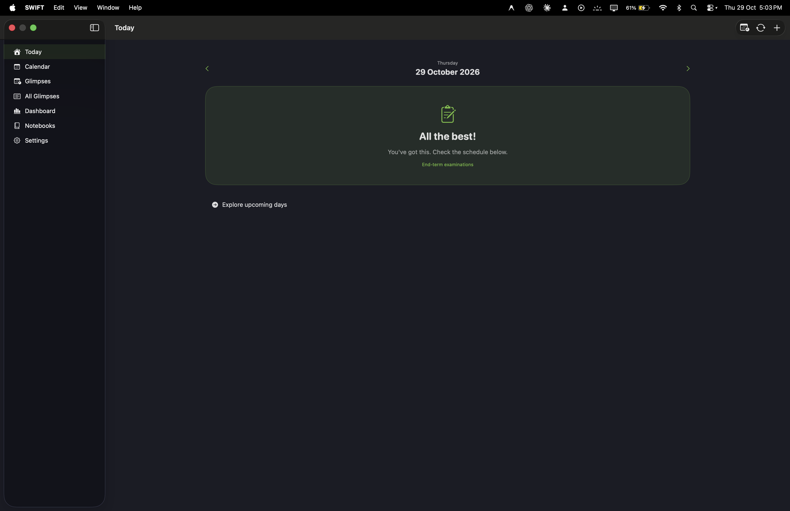

## iPad · Today

Landscape sidebar navigation and a holiday overview.

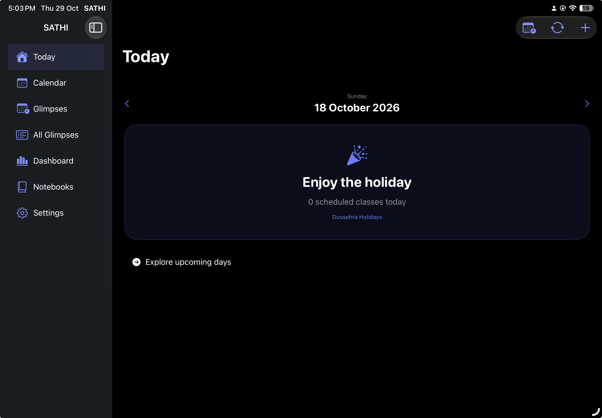

## iPhone · Calendar

Class and event markers for the selected month.

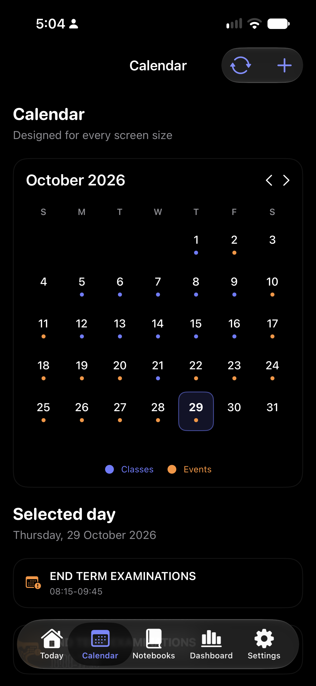

## iPhone · Semester setup

Semester selection for the academic year.

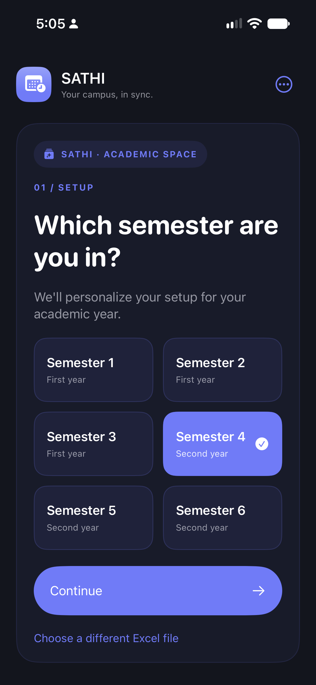

## iPhone · Subject selection

Electives and section selection.

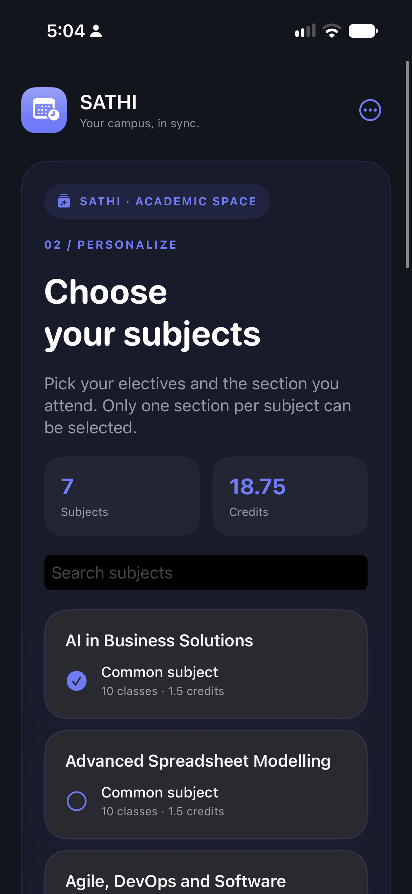

## iPhone · Import review

A review of the selected timetable subjects and credits.

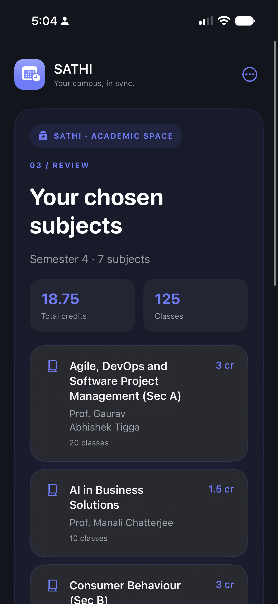

## iPhone · Appearance and reminders

Display, material, accent, text-size and sound controls.

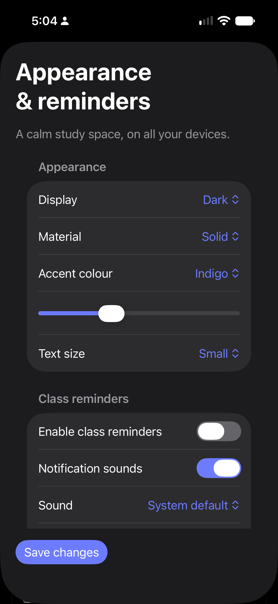

## iPhone · Settings

Account, sync and semester tools.

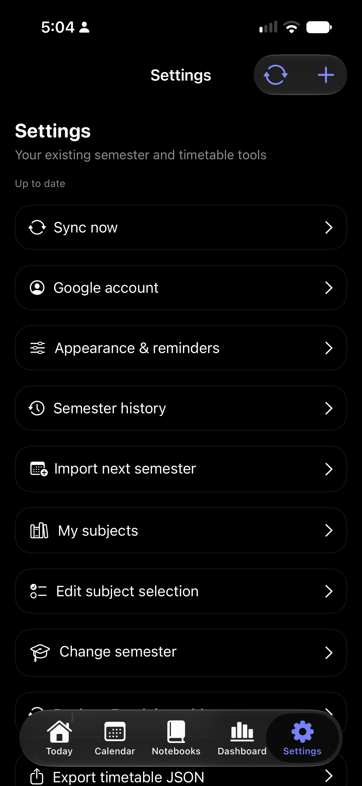

## iPhone · Today (earlier layout)

This older installed view includes repeated exam labels; the newer source consolidates all-day labels.

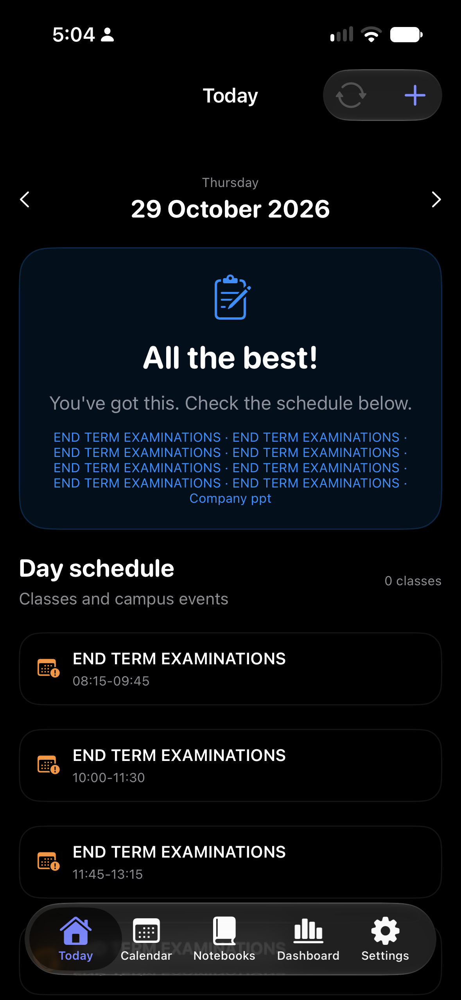

## iPhone · Dashboard (earlier layout)

Recorded attendance and course progress are distinct; unmarked attendance remains unknown.

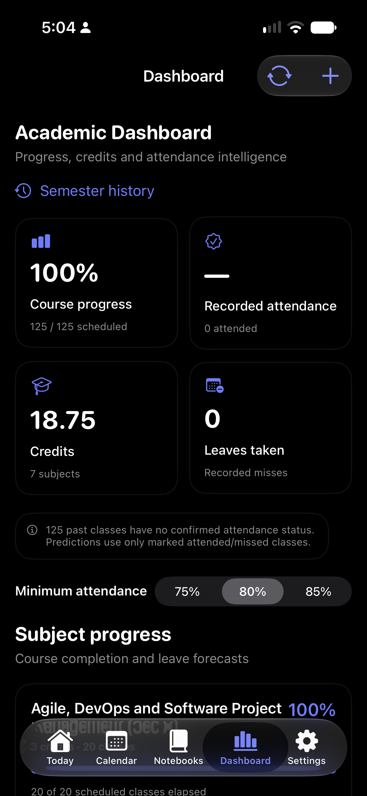

## iPhone · Notebooks (earlier layout)

The previous notebook page list. The source now includes a notebook library/editor redesign.

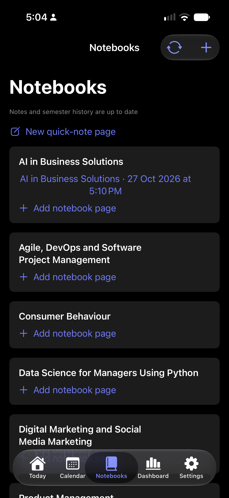
